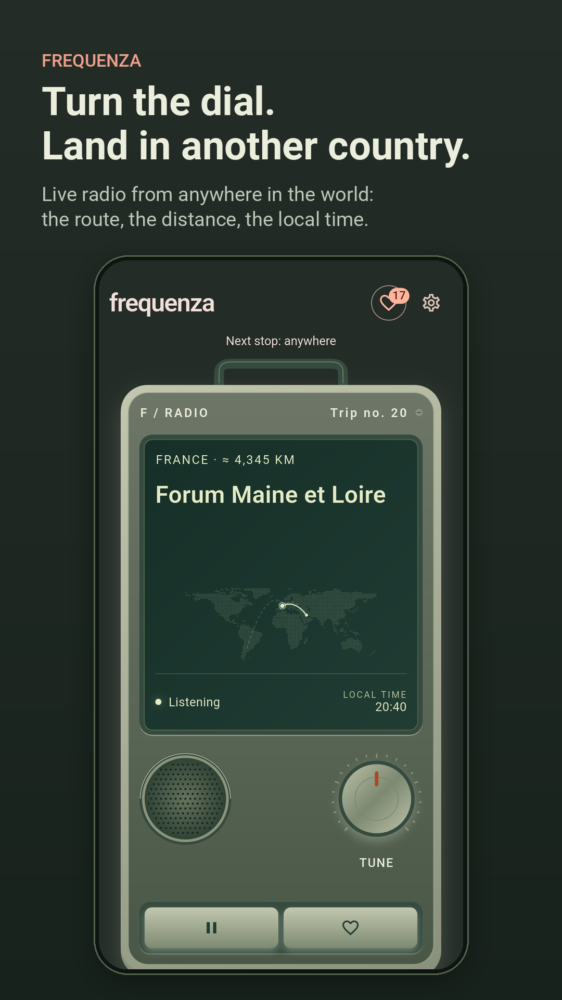
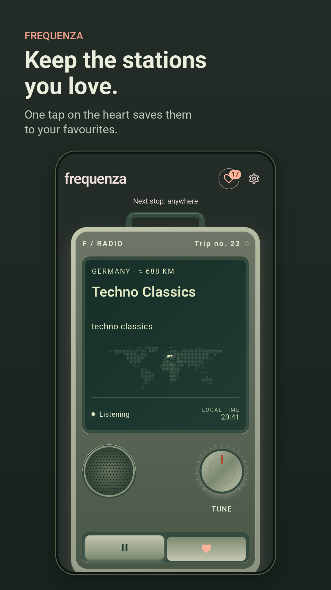

<p align="center">
  
</p>

<h1 align="center">Frequenza</h1>

<p align="center">
  <em>A travel radio. Turn the dial, land somewhere in the world.</em>
</p>

<p align="center">
  
  
  
  
</p>

<p align="center">
  
</p>

---

Somewhere, right now, a station in Paraguay is reading the news. A techno
classic is playing in Berlin. Someone in the Loire valley is taking calls.

**Frequenza** puts all of them behind a single dial. One turn, a soft crackle
of static, and you land on a live station somewhere on the planet. The map
draws the route of your trip, tells you how far you travelled and what time
it is over there. Then you turn again.

No account, no ads, no algorithm deciding what you should like. Just the
pleasure of getting lost on the airwaves.

## 📻 On air

<p align="center">
  
  &nbsp;&nbsp;
  
</p>

- 🎛️ **The dial.** Every turn is a flight to a random live station, from the free [Radio Browser](https://www.radio-browser.info) directory.
- 🗺️ **The trip.** A dotted world map draws the route from your last stop, with the distance and the local time of the station.
- 🎵 **What's on.** The title of the song on air, when the station sends it.
- ❤️ **Presets.** One tap on the heart keeps a station among your favourites, newest first.
- 🔙 **Back and forth.** Fly back to the previous stop, or on to the next one, also from the notification.
- 🌙 **Pocket radio.** It keeps playing with the screen off, with controls in the notification, on the lock screen and from your headphones.
- 🎨 **Two finishes.** Light or dark, in English or Italian.

## 🧭 How a trip works

```
 Off ──turn──▶ Flying ──the stream really plays──▶ On air ──turn──▶ Flying …
                 │                                     │
                 └── signal lost: retry, then Failed   └── paused · buffering · ended
```

1. **Take-off.** The radio picks a station and the static starts: a soft
   hiss, generated to sound like a dial sweeping across the band.
2. **The flight.** The stream loads in silence. A flight lasts at least a
   moment, even on a fast connection, and retries on its own if the signal
   is lost.
3. **Landing.** Only when the station really plays does the static fade out
   while the station fades in. The map, the distance and the clock follow.

## 🔧 Under the hood

A few decisions that shape the app, and why.

### 1. The radio is an explicit state machine
The whole radio is one sealed `RadioSession`: `Off`, `Flying`, `OnAir` or
`Failed`, each carrying its `Journey`. A pure `next(session, event)` function
decides every transition.
> **Why:** a radio has many moving parts (flights, retries, pauses from the
> headphones, streams that stall). Sealed states make impossible combinations
> impossible to write, and the transition table is tested without a player.

### 2. A flight is not a fetch
A station counts as found only when its stream is actually playing, never
when the request returns. Until then the player stays muted under the static.
> **Why:** many web radios answer and then never send a sound. Landing on
> silence is the worst thing a radio can do.

### 3. The service never leaves the foreground on a pause
Playback runs in an Android foreground service (`audio_service`), and it
stays there while paused. It leaves only when the radio really stops.
> **Why:** Android forbids an app in the background from going back to the
> foreground. A radio paused by a phone call and resumed from the headphones
> would otherwise be muted, then frozen by the system.

### 4. A watchdog for silent streams
A station stuck buffering for ten seconds is reconnected on its own.
> **Why:** live streams drop more often than files do, and a radio should
> recover without asking.

### 5. The static is generated, not downloaded
The tuning sound comes from a small Python script (`tool/tuning_sound/`):
filtered noise, a tone that drifts from dull to bright, faint stations
surfacing, and a loop with no seam. It starts at a random point on every flight.
> **Why:** reproducible, tweakable, and free of third-party licences.

### 6. No backend
Stations come straight from Radio Browser; favourites and history stay on the
phone. The world map is drawn from [Natural Earth](https://www.naturalearthdata.com) data.

## 🧰 Tech stack

- **Core:** Flutter 3.38, Dart 3.10
- **State:** Riverpod 2.6 with code generation; Freezed sealed unions
- **Audio:** just_audio, audio_service, audio_session, plus a small native player for the static
- **Navigation:** go_router
- **Translations:** easy_localization (English, Italian)
- **Storage:** shared_preferences

## 🚀 Build it yourself

You need the Flutter SDK 3.38 and an Android device or emulator.

```bash
git clone https://github.com/davidetarsi/frequenza.git
cd frequenza
flutter pub get
bash tool/generate_l10n.sh
dart run build_runner build --delete-conflicting-outputs
flutter run            # the dev flavour, installable next to the store app
```

Before a pull request, the same checks as the CI:

```bash
bash tool/check.sh          # format, analysis and every test
bash tool/check.sh --apk    # …and a release APK
```

## 🚦 From commit to store

- **develop:** every merge builds a dev APK and sends it to the testers' Telegram chat.
- **Versions:** a `version:major`, `version:minor` or `version:patch` label on the release pull request bumps the version.
- **main:** every merge builds the signed bundle for the Play Store closed test.
- **Store listing:** texts and images live in `fastlane/metadata/` and are published from a workflow.

## 💬 Ideas and bugs

Found a station that never lands, or dreaming of a feature?
[Open an issue](https://github.com/davidetarsi/frequenza/issues): every report helps.

## 🙏 Credits

- [Radio Browser](https://www.radio-browser.info), the community directory of internet radio stations.
- [Natural Earth](https://www.naturalearthdata.com), public domain map data.
- Every station on the dial, for broadcasting to whoever happens to tune in.

## 📄 License

[TO DECIDE]
